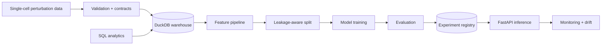

# Cell Perturbation ML Platform

A production-style machine-learning platform for **single-cell perturbation response modeling**.

This repository demonstrates the engineering and scientific judgment required to take a high-dimensional biological ML problem from raw data to a deployable product surface:

**data contracts → SQL warehouse → leakage-aware evaluation → model training → experiment registry → inference API → monitoring → cloud architecture**

It intentionally goes beyond a notebook demo.

## Why this project

Perturbation biology is a useful stress test for modern ML systems. The data are high-dimensional, batch-sensitive, scientifically structured, and easy to evaluate incorrectly if train/test leakage is ignored.

The default project uses deterministic synthetic single-cell perturbation data so the full system runs quickly in CI, while keeping the interfaces compatible with future adapters for public Perturb-seq/scPerturb-style datasets.

## What it demonstrates

- reproducible perturbation-data generation
- typed data contracts
- DuckDB analytical warehouse
- SQL-based dataset profiling
- leakage-aware train/test splits by perturbation
- multi-output gene-expression prediction
- biological + ML evaluation metrics
- experiment registry with model metadata
- FastAPI inference service
- model and feature versioning
- lightweight drift monitoring
- Docker + GitHub Actions
- AWS reference architecture for production deployment
- clear separation of data, modeling, serving, and observability

## Architecture



## ML problem

Each sample represents a biological context exposed to a perturbation under conditions such as cell type, dose, and batch.

The model predicts a vector of gene-expression changes relative to control.

The important evaluation choice is that the default test split holds out entire perturbations rather than randomly splitting rows. That makes the benchmark closer to the real question:

> Can the model generalize to perturbations it did not see during training?

## Quickstart

```bash
python -m venv .venv
source .venv/bin/activate
pip install -r requirements.txt

python -m src.generate_data
python -m src.warehouse
python -m src.train
python -m src.evaluate
uvicorn app.main:app --reload
```

Open API docs at `http://127.0.0.1:8000/docs`.

## Data warehouse

The generated dataset is loaded into DuckDB.

Example SQL:

```sql
SELECT
    perturbation,
    cell_type,
    COUNT(*) AS n_samples,
    AVG(dose) AS mean_dose
FROM perturbation_samples
GROUP BY 1, 2
ORDER BY n_samples DESC;
```

See `analytics/queries.sql` for more examples.

## Evaluation

The evaluation report includes:

- mean R² across genes
- mean Pearson correlation across genes
- RMSE
- top-response-gene overlap
- performance by cell type
- explicit split metadata

A single global metric can hide biologically important failure modes, so slice-level evaluation is part of the design.

## Experiment registry

Training writes model metadata to `artifacts/registry.json`, including:

- experiment ID
- timestamp
- model type
- feature schema version
- train/test perturbations
- metrics
- model artifact path

This lightweight registry mirrors the contract you would later move to MLflow, SageMaker Model Registry, or another production registry.

## API

| Method | Endpoint | Purpose |
|---|---|---|
| `GET` | `/health` | service health |
| `GET` | `/experiments` | latest experiment metadata |
| `POST` | `/predict` | predict perturbation response |
| `POST` | `/monitor/drift` | compare inference feature distribution with training reference |

## Repository layout

```text
app/                    FastAPI service
src/                    data, features, training, evaluation, monitoring
analytics/              SQL analysis
artifacts/              generated model/registry outputs
tests/                  regression tests
docs/                    architecture and production design
.github/workflows/      CI
Dockerfile
requirements.txt
```

## Production architecture

See [`docs/architecture.md`](docs/architecture.md).

The production reference design maps this project to:

- S3 for raw/curated data
- Glue + Athena or Snowflake for analytical data
- Step Functions / Airflow for orchestration
- SageMaker or ECS for training/inference
- Model Registry for promotion
- API Gateway + ECS/Lambda for serving
- CloudWatch/OpenTelemetry for monitoring
- IAM/KMS/private networking for security

## Why this is relevant to multiple roles

### Data Scientist
Shows SQL, experimental design, leakage-aware validation, segmentation analysis, model evaluation, and metric selection.

### ML Engineer
Shows training pipelines, artifact management, serving, monitoring, CI, Docker, and production boundaries.

### Solutions Architect
Shows modular architecture, cloud mapping, data/ML lifecycle, APIs, security considerations, and a reusable reference design.

### Bioinformatics / Computational Biology Scientist
Shows single-cell perturbation reasoning, batch/context awareness, biologically meaningful holdouts, and high-dimensional response modeling.

### Startup / Cofounder
Shows the ability to turn a scientific ML problem into an opinionated end-to-end product system.

## Public-data extension

The default dataset is synthetic for reproducibility. A production-ready next adapter can target a public Perturb-seq/scPerturb-style matrix while preserving the same contracts.

## Responsible use

This is a portfolio/reference system using synthetic data. It is not a validated biological assay, clinical model, or drug-development decision system.

## License

MIT
