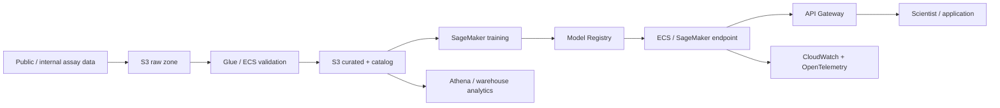

# Production Reference Architecture

## Design principles

- immutable raw data and versioned curated datasets
- explicit data, feature, and model versions
- promotion gates based on evaluation, not training success
- perturbation, batch, and cell-type holdouts
- async batch inference for high-throughput workloads
- least-privilege IAM, KMS encryption, private networking
- no raw biological data in application logs
- latency, error, drift, and model-version observability
